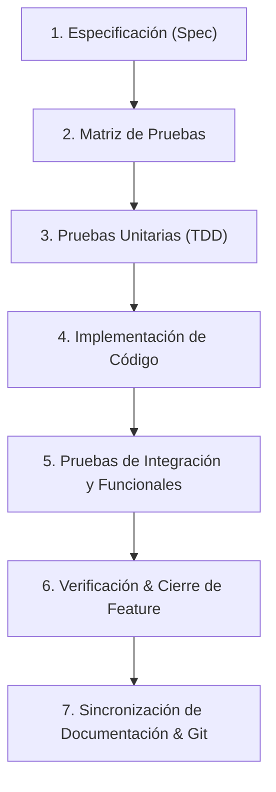

# Ciclo de Vida: Desarrollo Feature-by-Feature

Este documento define el ciclo formal de desarrollo que todo agente y desarrollador debe seguir para cada funcionalidad. Ninguna funcionalidad se considera completada sin pasar por todas las fases.

---

## Flujo de Trabajo

---

## Fases Detalladas

### Fase 1: Especificación Atómica (`spec.md`)
- Crear la carpeta de la feature: `docs/project/features/FEAT-XXX-<nombre>/`.
- Redactar `spec.md` basado en `feature_spec_tpl.md`:
  - **Objetivo**: Qué problema resuelve.
  - **Límites/Alcance**: Qué incluye y qué queda explícitamente fuera.
  - **Entradas / Salidas**: Contratos de datos, DTOs, interfaces.
  - **Criterios de Aceptación**: Formato *Given-When-Then* (Gherkin).

### Fase 2: Diseño de Matriz de Pruebas (`tests.md`)
Antes de codificar la solución, definir los tres niveles de prueba en `tests.md`:
1. **Pruebas Unitarias**:
   - Prueban funciones, clases o módulos aislados.
   - Mocks de dependencias externas (bases de datos, red, APIs).
   - Cobertura de casos límite (*edge cases*) y manejo de errores.
2. **Pruebas Integrales**:
   - Prueban la interacción entre módulos internos (p. ej. Servicio + Repositorio, Base de datos en memoria o de test).
   - Verifican contratos de API, serialización y transacciones.
3. **Pruebas Funcionales / E2E**:
   - Verifican flujos de usuario de extremo a extremo contra los Criterios de Aceptación.
   - Ejecución mediante llamadas reales o emuladas al sistema completo.

### Fase 3: Pruebas Unitarias Primer (TDD)
- Escribir las pruebas unitarias antes o en paralelo estricto con el código base.
- Las pruebas deben fallar inicialmente (*Red*).

### Fase 4: Implementación del Código
- Desarrollar la lógica mínima y limpia para hacer pasar las pruebas unitarias (*Green*).
- Refactorizar manteniendo el código limpio, desacoplado y documentado (*Refactor*).

### Fase 5: Pruebas de Integración y Funcionales
- Implementar y ejecutar las pruebas de integración y funcionales.
- Verificar que todos los criterios de aceptación se cumplan al 100%.

### Fase 6: Verificación y Definition of Done (DoD)
Una feature se considera terminada **únicamente** cuando:
- [ ] Todas las pruebas unitarias pasan (100% de éxito).
- [ ] Todas las pruebas de integración pasan.
- [ ] Todas las pruebas funcionales/E2E pasan.
- [ ] No se introducen advertencias ni regresiones en features previas.
- [ ] El código cumple con las reglas de estilo y tipado del proyecto.

### Fase 7: Sincronización de Documentación y Git
1. Actualizar `docs/project/features/FEAT-XXX/status.md` a estado `COMPLETED`.
2. Actualizar el tablero central `docs/project/status.md` marcando la feature como finalizada y apuntando a la siguiente feature en el backlog.
3. Actualizar `docs/project/architecture.md` o `database.md` si la feature introdujo nuevos módulos o modelos.
4. Generar el commit de Git atómico: `feat(FEAT-XXX): <descripción concisa>`.
