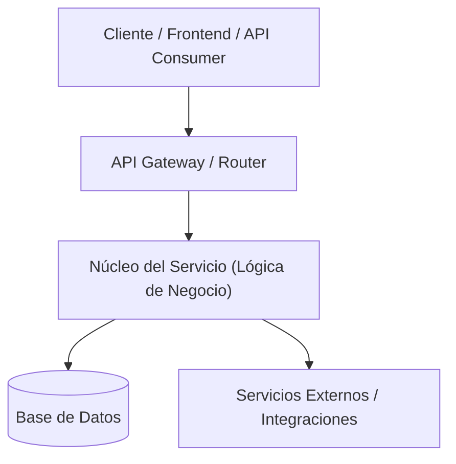

# Arquitectura del Sistema: [NOMBRE_PROYECTO]

## 1. Visión General y Objetivos
- **Propósito**: [Descripción del problema principal que resuelve el sistema]
- **Objetivos de Calidad**: [Rendimiento, escalabilidad, disponibilidad, seguridad, mantenibilidad]
- **Restricciones Técnicas**: [Límites de hardware, cloud, latencia, regulaciones]

## 2. Diagrama de Arquitectura de Alto Nivel

## 3. Patrones de Diseño y Capas
- **Estilo Arquitectónico**: [e.g., Clean Architecture, Modular Monolith, Hexagonal, Event-Driven]
- **Estructura de Directorios**:
  - `src/domain`: Entidades de negocio puras, reglas centrales sin dependencias externas.
  - `src/application`: Casos de uso, orquestación de servicios y puertos.
  - `src/infrastructure`: Adaptadores, repositorios concretos, clientes de base de datos y APIs externas.
  - `src/presentation` / `src/interfaces`: Controladores HTTP, CLI, consumidores de eventos.

## 4. Estrategia de Comunicación e Interfaces
- **Protocolos**: [REST, GraphQL, gRPC, WebSockets, Mensajería asíncrona]
- **Autenticación y Autorización**: [JWT, OAuth2, RBAC, API Keys]
- **Manejo Centralizado de Errores**: [Convención de códigos HTTP, excepciones de dominio, formato de error estandarizado RFC 7807]

## 5. Decisiones Clave de Arquitectura (ADRs)
| ID | Decisión | Motivo / Contexto | Consecuencias | Estado |
| :--- | :--- | :--- | :--- | :--- |
| ADR-001 | [Nombre de la decisión] | [Por qué se eligió esta alternativa] | [Ventajas y desventajas asumidas] | Aceptado / En Revisión |
