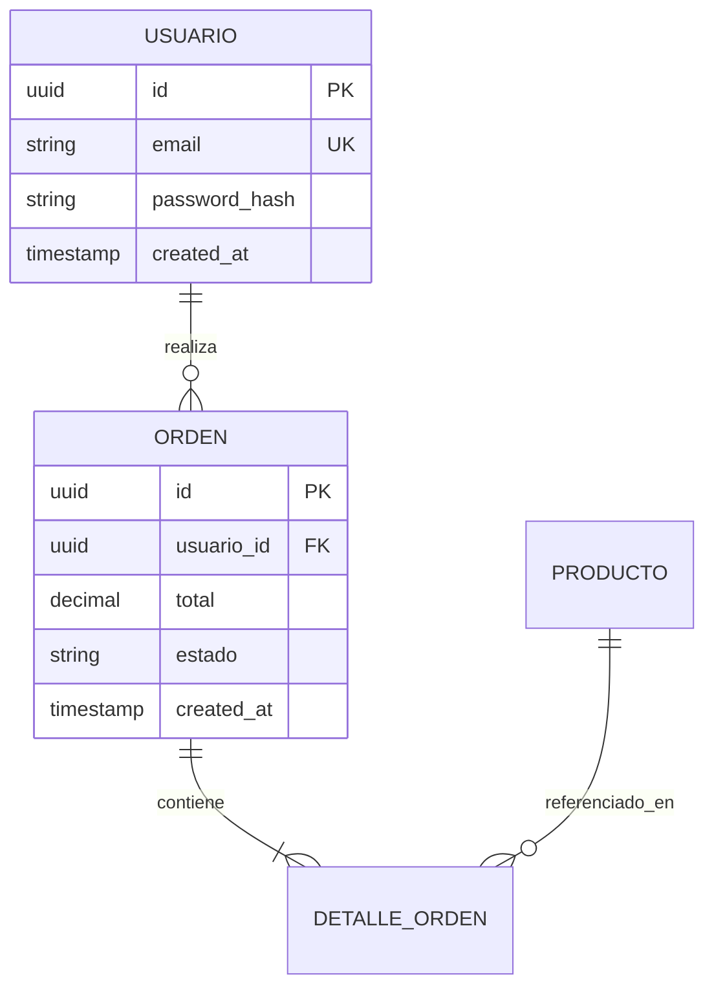

# Modelo de Datos y Persistencia: [NOMBRE_PROYECTO]

## 1. Motor de Base de Datos y Parámetros
- **Motor Primario**: [PostgreSQL / MySQL / SQLite / MongoDB / DynamoDB / Redis]
- **Versión**: [Versión objetivo]
- **ORM / Query Builder**: [Prisma / SQLAlchemy / TypeORM / Drizzle / SQL puro]
- **Estrategia de Conexión**: [Pool de conexiones, timeouts, réplicas de lectura]

## 2. Diagrama Entidad-Relación (ERD)

## 3. Diccionario de Datos y Tablas
### Tabla / Colección: `[nombre_tabla]`
| Columna / Campo | Tipo | Nulo | Por Defecto | Descripción | Restricciones / Índices |
| :--- | :--- | :--- | :--- | :--- | :--- |
| `id` | UUID | No | `uuid_generate_v4()` | Identificador único primario | PK |
| `created_at` | TIMESTAMP | No | `NOW()` | Fecha de creación del registro | Index |
| `updated_at` | TIMESTAMP | No | `NOW()` | Fecha de última modificación | - |

## 4. Estrategia de Migraciones y Versionado
- **Herramienta de Migración**: [e.g., Alembic, Prisma Migrate, Flyway, Knex]
- **Directorio de Migraciones**: `migrations/` o `prisma/migrations/`
- **Reglas**:
  - Toda alteración de esquema debe realizarse mediante un script de migración reversible (Up & Down).
  - Nunca modificar migraciones ya aplicadas en producción.
  - Los datos semilla para tests locales deben residir en `seeds/`.
