# Arquitectura y Diseño Técnico del Sistema

---

## 1. Visión General de la Solución
**Logos RC** es un simulador de auto a control remoto (RC) 3D interactivo construido sobre **TanStack Start** (React 19) y **Babylon.js**, controlado en tiempo real desde un smartphone mediante WebSockets utilizando el giroscopio y acelerómetro del dispositivo móvil (DeviceOrientation API).

### Diagrama de Flujo del Sistema

```mermaid
flowchart LR
    subgraph Mobile ["📱 Smartphone (Controlador)"]
        Sensors["Giroscopio / Acelerómetro<br/>(alpha, beta, gamma)"]
        UI_Mobile["Mobile Remote UI<br/>(Volante, Pedales, Nitro, Horn)"]
        Sensors --> UI_Mobile
        WS_Client_M["WebSocket Client<br/>(/controller?room=xyz)"]
        UI_Mobile --> WS_Client_M
    end

    subgraph Server ["⚡ TanStack Start / WebSocket Server"]
        WS_Relay["WebSocket Room Router<br/>(Zero-latency broadcast)"]
    end

    subgraph Desktop ["🖥️ Pantalla Principal / Auto 3D"]
        WS_Client_D["WebSocket Client<br/>(Host / Receiver)"]
        Physics["Arcade RC Physics Engine<br/>(Inercia, Derrape, Suspensión)"]
        BabylonScene["Babylon.js 3D Engine<br/>(Auto RC, Pistas, Sombras, Partículas)"]
        HUD["Desktop Telemetry HUD<br/>(Velocímetro, QR Code, Latencia)"]
        
        WS_Client_D --> Physics
        Physics --> BabylonScene
        BabylonScene --> HUD
    end

    WS_Client_M <-->|Paquetes de Control @ 60Hz| WS_Relay
    WS_Relay <-->|Telemetría & Eventos Colisión| WS_Client_D
```


---

## 2. Pila Tecnológica (Tech Stack)
- **Framework Full-Stack**: TanStack Start (`@tanstack/react-start`, `@tanstack/react-router`) con Vite.
- **Motor 3D WebGL/WebGPU**: Babylon.js (`@babylonjs/core`, `@babylonjs/loaders`).
- **Comunicación en Tiempo Real**: WebSockets nativos (`ws` en servidor, WebSocket browser API en cliente) con ruteo de salas (*rooms*).
- **Estilos y UI**: Tailwind CSS v4 con Lucide React.
- **Detección de Movimiento**: `DeviceOrientationEvent` (iOS 13+ con solicitud de permiso por gesto de usuario, Android con normalización y calibración de punto neutro).
- **Audio Sintetizado**: Web Audio API para simulación de motor, bocina, aceleración nitro y derrapes sin dependencias de archivos estáticos.

---

## 3. Topología de Módulos y Rutas
```text
logos-rc/
├── src/
│   ├── routes/
│   │   ├── __root.tsx           # Layout base HTML, head y scripts
│   │   ├── index.tsx            # Pantalla 3D del Auto RC, Pista y HUD
│   │   └── controller.tsx       # Interfaz móvil de control remoto giroscópico
│   ├── components/
│   │   ├── BabylonCanvas.tsx    # Canvas WebGL y orquestador del loop de render
│   │   ├── DesktopHUD.tsx       # Panel de instrumentos, QR code, latencia y cámaras
│   │   ├── MobileWheel.tsx      # Visualizador de inclinación y volante giroscópico
│   │   └── QRCodeModal.tsx      # Modal de emparejamiento rápido con móvil
│   ├── engine/
│   │   ├── CarModel.ts          # Construcción procedural de malla del auto RC
│   │   ├── TrackEnvironment.ts  # Escenario de pista, rampas, conos y obstáculos
│   │   ├── VehiclePhysics.ts    # Motor físico arcade (aceleración, derrape, suspensión)
│   │   └── SoundEffects.ts      # Síntesis de sonido Web Audio
│   ├── net/
│   │   ├── protocol.ts          # Contratos y tipos de datos WebSocket (paquetes)
│   │   └── wsClient.ts          # Cliente WebSocket con auto-reconexión y buffer
│   ├── router.tsx               # Instancia de TanStack Router
│   └── styles/
│       └── app.css              # Estilos Tailwind CSS
├── server/
│   ├── ws-relay.ts              # Lógica de salas WebSocket reutilizable
│   └── ws-server.mjs            # Servidor WebSocket standalone
└── vite.config.ts               # Configuración Vite con plugin TanStack Start y WS dev
```
